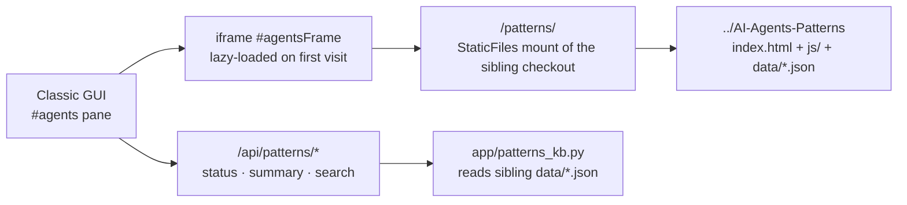

# Agent Patterns & Advisor tab

The **Agent Patterns & Advisor** tab (`#agents` in the Classic GUI) embeds the sibling
**AI-Agents-Patterns** project: an advice-first knowledge base for designing
and deploying AI agents — *what to build, what goes wrong, how to protect
it*. It complements this repo's evidence-first surfaces: the Security agent
says what *this* product's residual is from stored rows; the Patterns tab
says what the field has learned about the failure mode in general.

Related: [frontend](frontend.md) · [architecture](architecture.md) ·
[security-agent](security-agent.md) · [operations](operations.md)

## What the catalog holds

Live counts at `GET /api/patterns/summary` (currently 107 design patterns,
43 failure scenarios, 180 composition cascades, 39 replayable mock traces):

| Tab in the embedded SPA | What it is |
|---|---|
| Overview | Architect dashboard: readiness, blueprint risk/exposure, deterministic "Next" suggestion, report export |
| Fox – Architect | Local-model copilot grounded in the catalog (deterministic offline fallback) |
| Patterns | 107 design patterns across 9 categories, with failure modes, protections and control-flow diagrams |
| Scenarios | 43 failure scenarios across 15 domains (critical / high / medium), each with attack chain, protection table, detection signals and incident response |
| Cascades | 180 composition cascades in four classes (inherent, derived, emergent, cascading) with propagation paths and a simulator |
| Coverage | Control-family coverage: what the catalog's patterns cover and what they don't |
| Deployment Plan | Intake → readiness scorecard → stack recommendation → guardrail config → rollout dial → residual-risk register → ADR generator |
| Blueprints | Reference-architecture builder from templates or the pattern palette, with cost/latency/risk estimator and per-blueprint threat model |
| Live View | One replayable mock trace per scenario: control-flow diagram, step tracker, budget/token gauges, event log |
| Design & Architecture | UML and architecture documents with live Mermaid (same pattern as this repo's Design tab) |
| Guardrail Lab | Type an agent idea; a deterministic rule engine returns risk score, design proposals, guardrail architecture, cascade-aware rules, a mock run and a rollout plan |

## How it is wired

* **Same-origin mount.** `app/main.py` serves the sibling directory at
  `/patterns/` (overridden by `AKM_PATTERNS_DIR`), so the SPA loads with no
  second port and no CORS. The GUI lazy-loads the iframe on first visit and
  sizes it like the Standards frame; the selected tab is in the hash
  (`#agents`), so it deep-links.
* **Read-only JSON API.** `app/patterns_kb.py` reads the sibling's
  `data/*.json` (cached by mtime) for this app's own surfaces: the tab badge
  (total catalog entries), the advice header above the frame, and lexical
  search (`GET /api/patterns/search?q=&kind=&limit=`) whose hits name their
  kind and id so the tab can link to the owning SPA view. Search is
  deliberately lexical, not ranked retrieval: the catalog is the authority,
  and the endpoint is an index into it, not a paraphrase of it.
* **Graceful absence.** No caller-supplied path ever becomes a filesystem
  path — the only input is the directory itself. When the sibling checkout
  is absent (e.g. a minimal image), the mount is skipped, the API reports
  `available: false` with a reason, and the pane shows that reason instead
  of a broken frame. One unreadable data file zeroes its own count and is
  reported in `files`, without sinking the rest.

## How to use it with an assessment

1. Run a security assessment as usual (AI Security tab).
2. Open the **AI Agents** tab for the general playbook: the scenario that
   matches your threat, the cascade class it composes into, and the
   deployment-plan guardrails that contain it.
3. Use the **Guardrail Lab** to turn your own agent idea into a mock run
   (blocked attack path vs approved legitimate path) before writing a
   control plan; use **Blueprints** to compose patterns into a
   reference architecture with a threat model.

The Fluid UI lists **AI Agents** in its nav rail as a not-yet-built
workspace; its page points at the Classic `#agents` tab and the
`/api/patterns/*` endpoints that will back it.

## Caveats, honestly

The catalog's exposure figures measure matched threat *surface*, not measured
risk — compare like-for-like blueprints. Cost/latency numbers are estimates
from stated assumptions, not benchmarks. And the two systems answer different
questions: a catalog scenario never substitutes for evidence in *your*
corpus — it tells you where to look, not what you will find.
