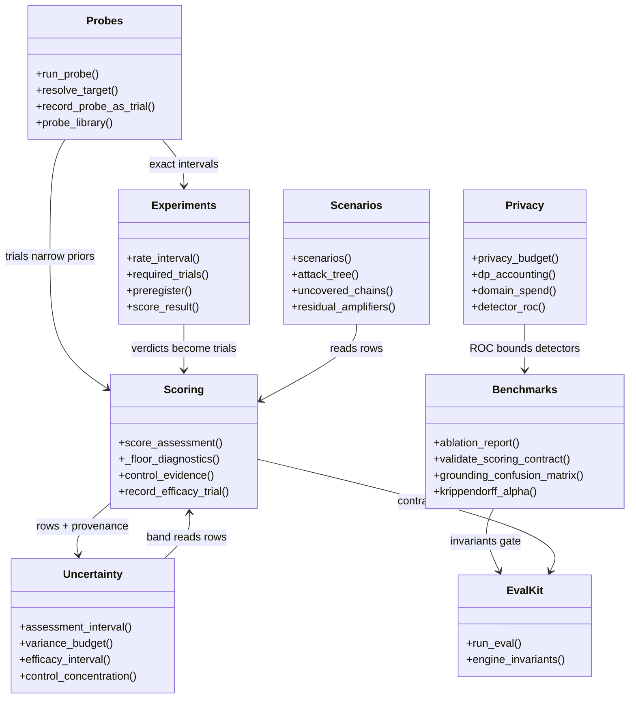
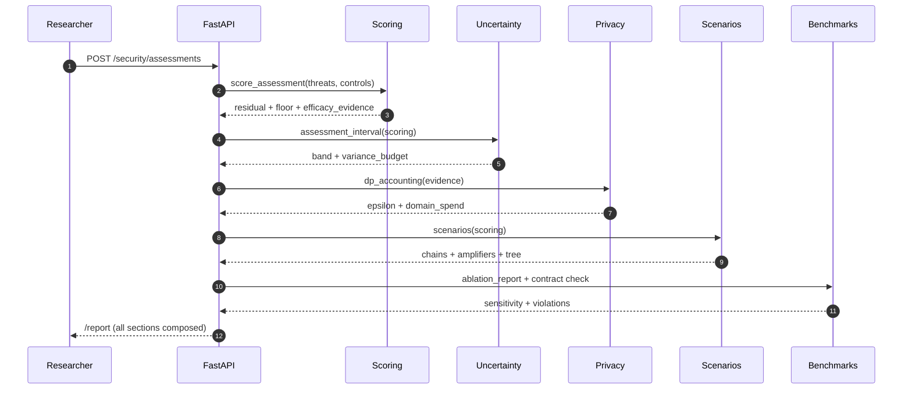
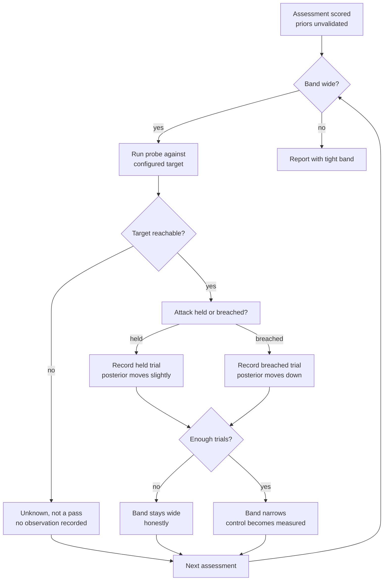
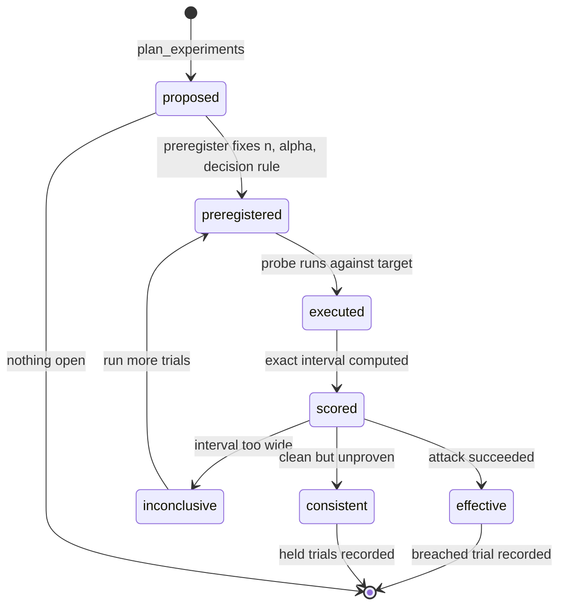
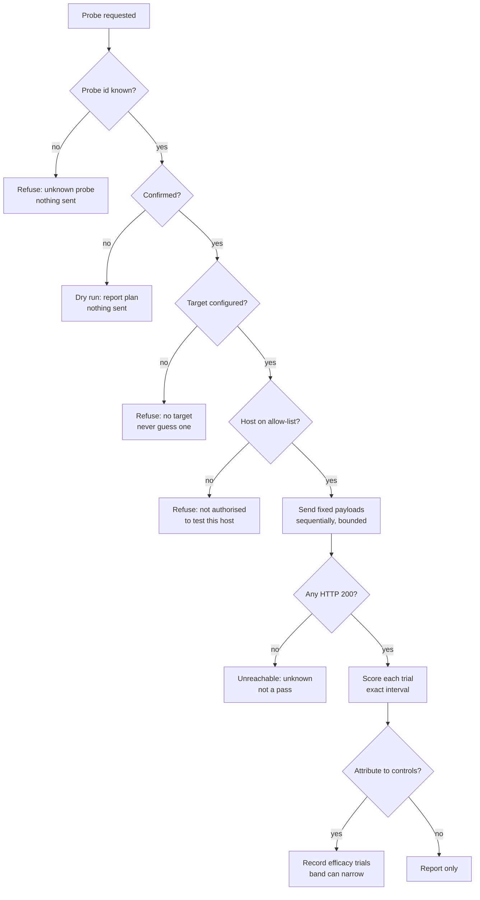
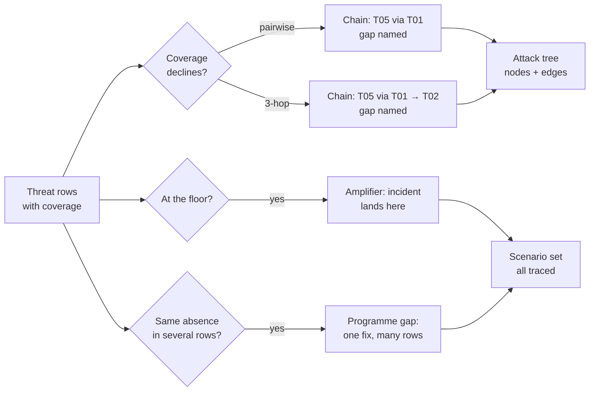
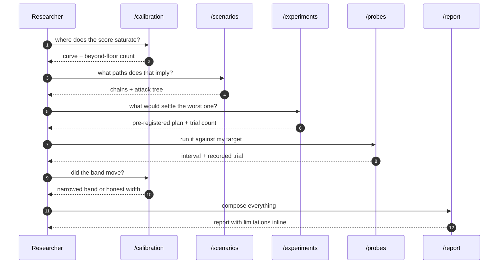

# Analysis engine

How a residual becomes a *measured* number: the calibration layer, the attack
scenarios, the probes, and the report that carries all three. This document is
for the reader who wants to know what the engine claims, what it refuses to
claim, and where each number comes from.

Related: [architecture](architecture.md) · [security-agent](security-agent.md) ·
[threatpack](threatpack.md) · [data-model](data-model.md) · [privacy](privacy.md)

## The problem it solves

`score_assessment` is deliberately arithmetic: inherent × (1 − coverage),
floored. That is what makes a number quotable, and it is also what makes a
single figure look more certain than the evidence behind it. Three facts make
that untenable, and each was measured before it was addressed:

1. **The score saturates.** Likelihood never falls below 35% of inherent, so
   the headline stops responding to controls once coverage passes 65%.
   Declaring all fifteen controls moves the residual 68.8 → 24.2, then
   flatlines — the last six are worth 0.0.
2. **Every efficacy is an estimate.** All fifteen control efficacies are
   single-analyst judgements with no external validation. The cited standard
   establishes that the control exists, not how effective it is.
3. **The catalogue is a checklist.** It can only report what was already
   thought of. A partially-mitigated system yields 39 derived scenarios its
   per-row scores cannot show.

The engine answers each with a different instrument, and the instruments
compose: the band widens under an unvalidated prior, the floor names the
controls it froze, the scenarios name the paths the rows imply, and the
probes are what can eventually narrow all of it.

## Components (UML)

`Scoring` (`app/scoring.py`) is the only module that produces a number; every
other module reads its output, questions it, or narrows it. Nothing here
re-derives the residual — the band, the budget, the scenarios and the report
all describe *this* result rather than computing their own. That one-way
dependency is what makes the guarantees composable instead of circular.

## Assessment to calibrated result (sequence)

The ordering is the argument. The limitations — the variance budget, the
saturation count, the unvalidated efficacies — travel *with* the number in the
same response, because a limitations section at the end of a report is a
disclaimer, and the same limitations immediately after the number are part of
the result.

## The observation loop (activity)

This is the diagram that matters most. Everything else in this document is a
snapshot; this is the process by which the snapshots get better:

Two properties make this a research instrument rather than a dashboard widget.
First, a single trial barely moves anything (0.70 → 0.76): tightening the band
*requires repeated outcomes*, which is exactly what should be demanded before a
"measured" claim. Second, a skipped or unreachable run records nothing — "could
not tell" never becomes "no problem".

## Experiment lifecycle (state)

The states a result can land in are deliberately asymmetric. There is no
"passed" state: `supported_but_unmeasured` is consistent-with-the-claim, not
proof of it, and `inconclusive` carries the recommended trial count rather than
a failure. A clean run over too few trials is the most common way a red-team
exercise overclaims, so it gets its own state instead of being rounded up.

## Probe execution (activity)

Five exit paths refuse or report unknown, one path executes. That ratio is the
safety envelope made visible: a probe harness that could pick its own target
would be a vulnerability, not an instrument.

## Scenario derivation (flowchart)

The ordering constraint is what makes multi-hop enumeration tractable and
meaningful: a path only extends while coverage *falls*. Without monotone
decline the enumeration is combinatorial and says nothing. On the shipped
catalogue a four-control posture yields 24 chains, 8 amplifiers and 7
programme gaps — 39 findings no per-row score produces. Fully mitigated, the 13
remaining are all distinct (endpoint, gap) pairs, never restatements.

## Researcher interaction (sequence)

This is the PhD-level workflow the tool supports: calibrate → derive → plan →
execute → re-calibrate → publish. Each step names what it does not know, so
the loop converges on measured claims rather than on confident ones.

## What is measured, what is not

| Property | Status | Where |
|---|---|---|
| Residual saturation | measured (leave-one-out ablation) | `floor` block |
| Efficacy provenance | recorded (basis, n, concentration) | `control_evidence` |
| Interval width | propagated from provenance | `assessment_interval` |
| Variance attribution | decomposed (signed interaction) | `variance_budget` |
| (ε, δ) composition | accounted, **not enforced** | `dp_accounting` |
| Detector reliability | bounded (AUC 0.95 / 1.00) | `detector_roc` |
| Trial rates | exact (Clopper-Pearson) | `rate_interval` |
| Agreement | κ + α + AC1 side by side | `inter_rater` |
| Contract drift | pinned (24 invariants) | `engine_invariants` |

The one row in bold is the most important in the table. The engine adds no
noise, so `dp_accounting` returns `mechanism: "accounted-not-enforced"` and
states in its own note that this is NOT a differential-privacy guarantee — and
an invariant enforces the caveat, so a future edit cannot quietly drop it.
