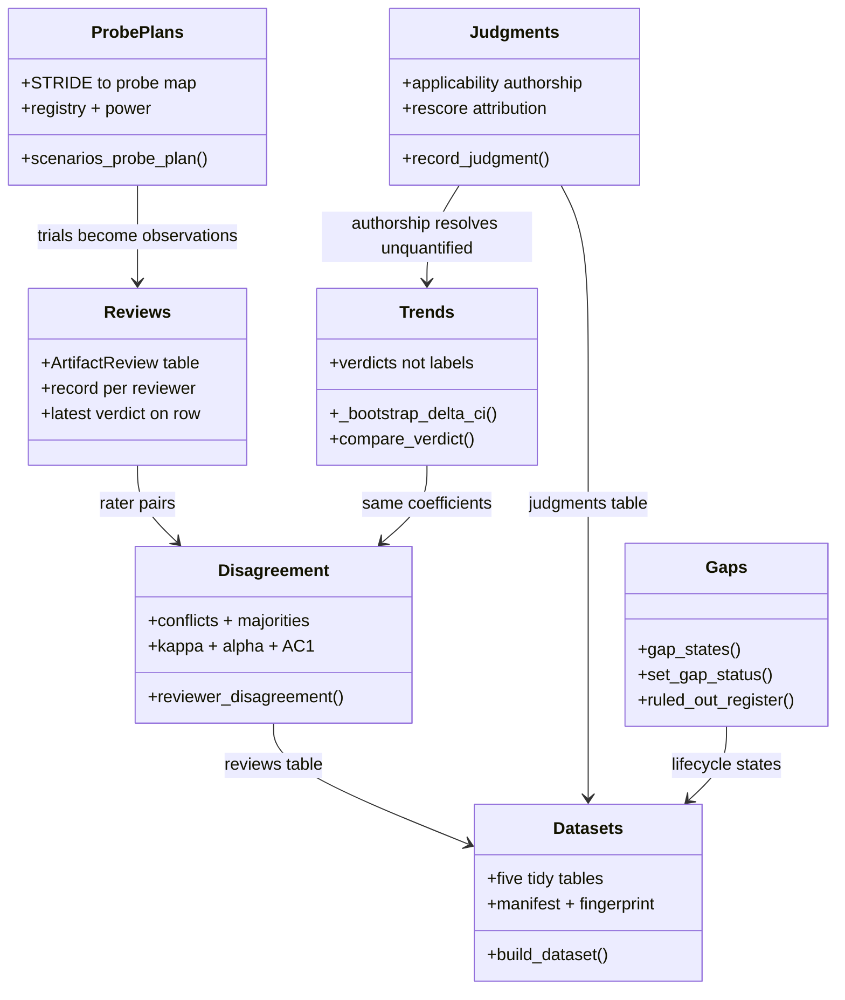
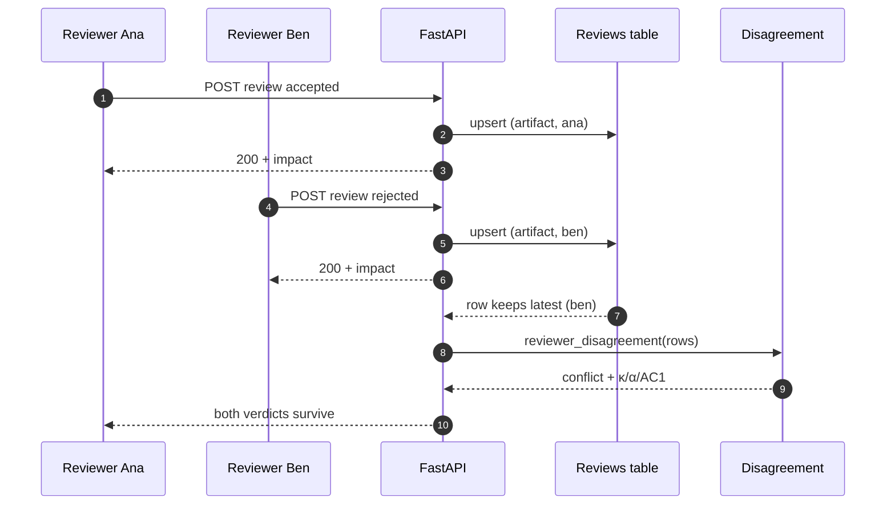
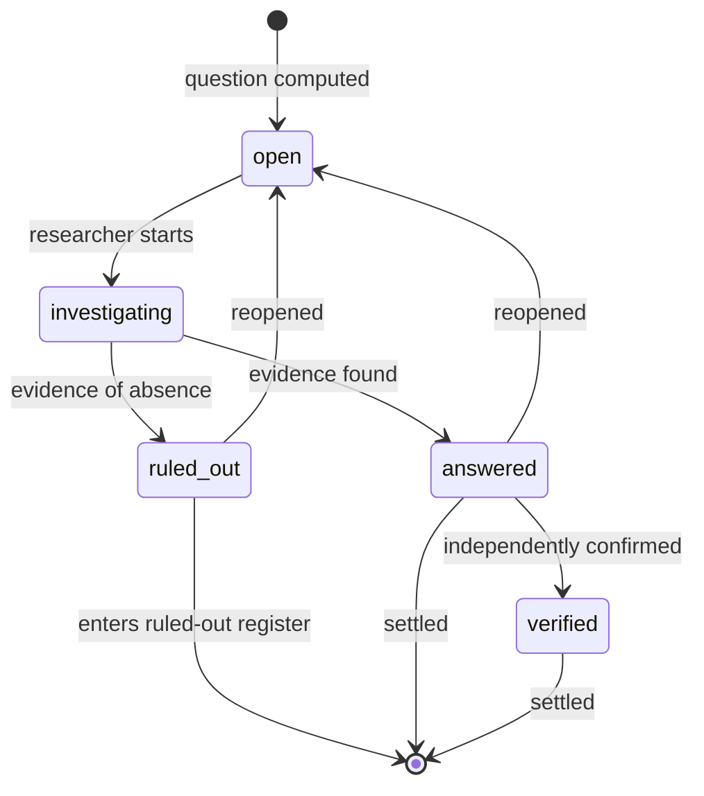
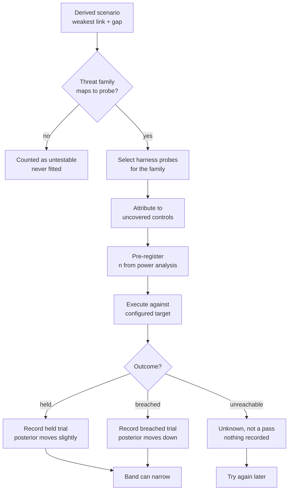
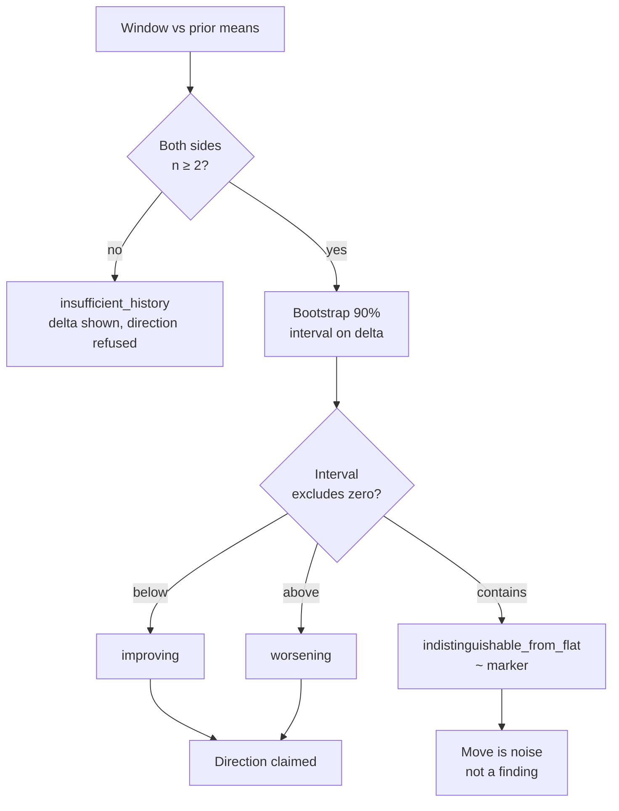
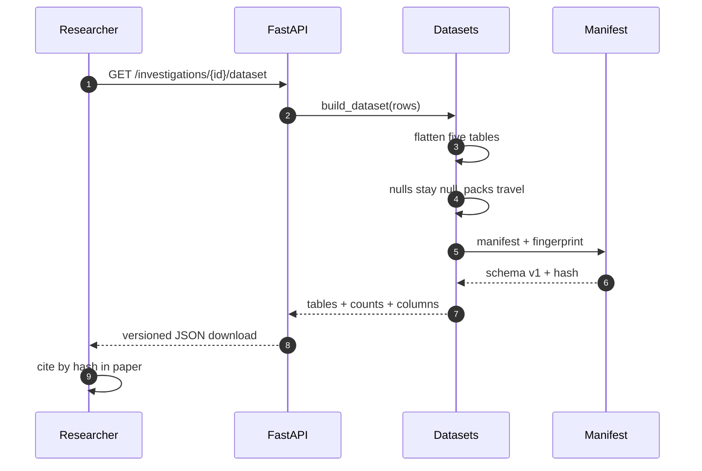
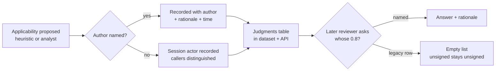

# Group research

How several researchers share one tool without destroying each other's work,
and how everything the group produces can leave the tool for analysis
elsewhere. This is the companion to [analysis-engine](analysis-engine.md):
that document describes how a residual becomes a measured number; this one
describes how a *group* produces measured numbers together.

Related: [analysis-engine](analysis-engine.md) · [architecture](architecture.md) ·
[ledger](ledger.md) · [data-model](data-model.md)

## The problem it solves

A single researcher using this tool gets honest numbers. A group sharing it
got three structural failures, each measured before it was addressed:

1. **Reviews overwrote each other.** `artifacts.review` held one verdict, so
   the second reviewer judging an artifact destroyed the first's work
   everywhere except the ledger. Disagreement — the input to every
   inter-rater statistic — was unrepresentable.
2. **Nothing could leave the tool.** Every analysis a group might do in R or
   Python required scraping the API row by row. There was no versioned,
   fingerprinted dataset to cite.
3. **Trends claimed direction inside noise.** Every trend strip compared two
   means and labeled the direction from the sign of the delta — on n=2 vs n=3
   identically to a real move.

The instruments below address each in turn, and they compose: attributed
reviews feed measured agreement, measured agreement feeds the calibration
pages, and the dataset carries all of it out.

## Components (UML)

`Reviews` is the only module that stores group input; everything else reads
it. Disagreement feeds the same κ/α/AC1 machinery the engine uses for
rater reliability, so a group's self-measurement and the engine's
self-measurement are one system, not two. The dataset carries every table
out, which is what makes the group's work citable rather than merely
visible.

## Review to measured agreement (sequence)

The row keeps the latest verdict for its pre-existing readers, but no
judgment is destroyed: the upsert is per (artifact, reviewer), so "who
currently believes what" is always answerable. The disagreement call then
turns the pair into coefficients — on skewed accept-heavy verdicts the three
visibly diverge (κ=0.0, α=0.0, AC1=0.33 on the fixture), which is why all
three ship rather than κ alone.

## Gap lifecycle (state)

Two properties make this a research instrument rather than a status column.
First, ruling out without named evidence is refused — "we looked and found
nothing" is only a finding when it says what looking meant. Second, reopening
is allowed but recorded as a new decision, never an edit: the row keeps the
latest state and the ledger keeps the history, so a reversal is visible
rather than silent.

## Scenario to probe (activity)

This is the loop the product name promises: a derived scenario becomes the
probes that would test it, with the controls an outcome is attributed to. The
mapping is explicit (STRIDE family to harness attack class) and narrow — a
scenario with no matching probe is counted, never fitted with an unrelated
one. Each plan carries its trial count from power analysis, so a plan that
needs 84 trials says so instead of proposing 30.

## Trend verdict (flowchart)

The old label was the sign of a mean difference with no test behind it; on
n=2 vs n=3 it was indistinguishable from noise and presented identically to
a real move. The verdict refuses direction inside noise, and the classic
board renders that refusal with a `~` marker. The same discipline governs
comparisons: two overlapping bands render as "indistinguishable" with the
overlap share, never as a delta begging to be quoted.

## Dataset export and citation (sequence)

Re-exporting the same rows yields the same fingerprint, so a paper cites the
dataset by hash rather than by download date. Scores travel with the pack
version that produced them; residuals travel with their floor flag and
provenance; artifact content is never exported, only digests — a dataset that
carried full text would be a redistribution mechanism for third-party
content.

## Judgment authorship (flowchart)

Likelihood, impact and applicability are analyst assignments, and the
variance budget lists them as unquantified. They stay unquantified forever
until judgments carry authorship — calibration needs someone to ask and
something to calibrate against. Legacy rows report an empty list rather than
gaining an author retroactively, because backfilling authorship would be a
false claim about how the row was produced.

## What the group gets

| Capability | Before | After |
|---|---|---|
| Two reviewers, one artifact | last write wins | both verdicts survive + disagreement measured |
| Agreement | unmeasurable | κ/α/AC1 over rater pairs |
| External analysis | scrape the API | versioned dataset cited by hash |
| Trend direction | sign of a mean difference | verdict only outside noise |
| Comparing assessments | subtract the headlines | distinguishable / overlapping / unmeasured |
| Experiment plans | round-default trials | n from power analysis |
| Scenario testing | adjacent tabs, no wire | one click from finding to falsification |
| Ruled-out questions | reappear as open | register with evidence |
| Who set each weight | unanswerable | judgments table |
