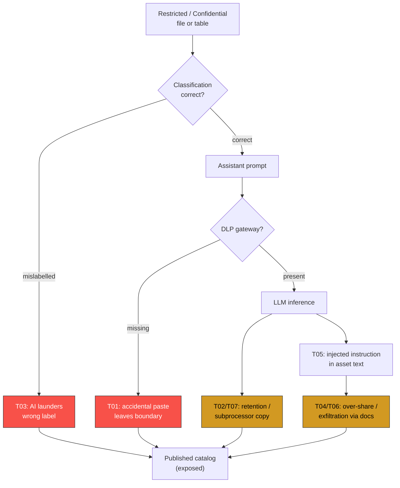
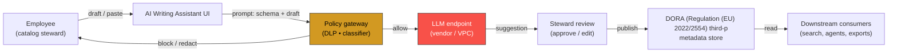
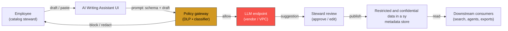
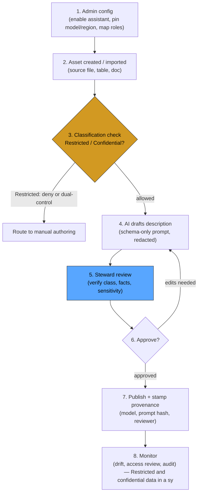

# Run summary report — #1

_Manager run #1 · status compiled · created 2026-10-13 12:56 UTC · 3 investigation(s) · summary #5_

**Command:** Assess the security risk of adopting the Collibra AI Writing Assistant on restricted/confidential data, for an organisation like SWIFT (a systemically important financial market infrastructure) subject to DORA.

=== ADOPTION ASSESSMENT REPORT (context) ===
# Adoption advice — Collibra AI Writing Assistant

_Organisation:_ financial market infrastructure (payments, clearing, settlement, messaging); systemically important / critical function; subject to EU DORA (digital operational resilience), EU GDPR; restricted data; cross-border processing · _Question:_ security_risk · _Method:_ adoption_advice_v1 v1.1.0 (`f4366d380b87`) · _Generated:_ 2026-10-13T11:53:55 UTC

---

## Verdict

**Do not adopt at this organisation profile without change.** High-or-critical items remain after controls.

Measured residual (worst prior analysis): 80.3/100 · organisation scrutiny ×1.8 (high) · adoption pressure 100/100.

## Organisation nature

| Field | Reading |
|---|---|
| Sector | financial market infrastructure (payments, clearing, settlement, messaging) |
| Systemically important | yes |
| Data sensitivity | restricted |
| Supervisory regimes | dora, gdpr |
| Jurisdiction | unstated |
| Cross-border | yes |
| Third-party reliance | yes |

## Why the organisation raises the bar

| Factor | Δ scrutiny |
|---|---|
| financial market infrastructure (payments, clearing, settlement, messaging) | +0.3 |
| systemically important / critical function | +0.25 |
| EU DORA (digital operational resilience) | +0.15 |
| EU GDPR | +0.1 |
| restricted data in scope | +0.2 |
| cross-border processing | +0.1 |
| third-party reliance | +0.05 |

## Referenced prior analysis

The advice below quotes, and does not re-derive, these stored results.

| Analysis | Product | Exposure | Residual | Posture | Matched on |
|---|---|---|---|---|---|
| Collibra AI Writing Assistant on restricted/confidential data (DORA SIFMI) | Collibra AI Writing Assistant | Restricted data | 80.3/100 | HIGH RISK — do not enable for this data tier without the mitigations below | product_family |

## Conditions

Each condition names what it buys and what remains when it is in place.

| # | Condition | Why | Residual limitation | Source |
|---|---|---|---|---|
| AA01 | Classification gate and allow-list before the surface | restricted content may reach the model output, so the input surface must be restricted to classified, allow-listed material. | A gate is only as good as the labels it reads; one misclassified input defeats it. | organisation nature |
| AA09 | DLP and egress allow-list on prompts and responses | Confidentiality loss is the primary failure mode at this tier. | DLP misses paraphrased secrets and novel formats; it reduces, never eliminates, leakage. | organisation nature |
| AA07 | DPIA / data-protection assessment before production | Personal data processing triggers a documented assessment. | A DPIA records a decision; it is not itself a control. | organisation nature |
| AA03 | Residency and transfer mechanism pinned in contract and config | Processing crosses a border, so location and transfer basis must be fixed, not assumed. | Residency attestations often omit backup, replication and support-access regions. | organisation nature |
| AA04 | No-train and zero-retention terms, evidenced not declared | A third party receives the data, so retention and training use must be contractually barred and technically confirmed. | A no-train clause does not prove deletion, nor stop on-path logging by a subcontractor. | organisation nature |
| AA05 | Resilience, exit plan and concentration limits (DORA-style) | A critical function cannot depend on a supplier it cannot leave. | An exit plan untested at scale is a document, not resilience. | organisation nature |
| AA10 | Supervisory audit trail and incident reporting path | Supervisors will ask who did what and when. | An audit trail proves an action occurred, not that it was appropriate. | organisation nature |
| AA06 | Human review in the loop for restricted outputs | At this consequence, an unreviewed output is not acceptable. | Review degrades to rubber-stamping as volume grows. | organisation nature |
| AA08 | Least-privilege roles and SSO-bound access | The surface must not exceed the user's own entitlements. | Role drift and shared accounts quietly exceed the intended boundary. | baseline |
| AA11 | Logging and provenance on every model interaction | Without a record, neither misuse nor benefit is provable. | Logs prove the interaction happened, not that it was appropriate. | baseline |
| AA12 | Staged rollout behind a bounded pilot with stop criteria | The measured residual (80.3/100) does not support an unbounded production launch. | A pilot ticks a box unless it has a pre-agreed abort threshold. | prior analysis |

## What is missing

- Residual blocker T01: Accidental paste of sensitive content into the AI assistant (25.0/100)
- Residual blocker T02: Model training / retention leakage of submitted metadata (20.0/100)
- Residual blocker T03: Misclassified / mislabelled source files propagate via AI suggestions (20.0/100)
- Residual blocker T04: Over-permissive AI-generated descriptions leak schema semantics (16.0/100)
- Residual blocker T06: Insider exfiltration through generated documentation (15.0/100)

## Limitations

- This pack is deterministic and organisation-aware; it is not a control-level assessment and does not replace one.
- The organisation's nature is read from the request text and any explicit fields; unstated fields are treated as unstated.
- Prior-analysis numbers are quoted from stored rows, not re-derived, and move only when those rows do.
- No condition here is a clean bill of health; each carries the limitation that remains when it is in place.

---
*Organisation nature scales consequence, it does not measure the product. The product numbers are quoted; the conditions are the part you can act on, and each keeps its residual.*

## Collibra AI Writing Assistant - data-processing architecture, inference providers & retention  _(investigation #2)_

**Residual 68.6 / overall 68.6** · path `standard`

| ID | Risk | Severity | Inherent | Residual | Coverage |
|---|---|---|---|---|---|
| T01 | Accidental paste of sensitive content into the AI assistant | — | 25 | 25 | 0% |
| T02 | Model training / retention leakage of submitted metadata | — | 20 | 20 | 0% |
| T03 | Misclassified / mislabelled source files propagate via AI suggestions | — | 20 | 20 | 0% |
| T04 | Over-permissive AI-generated descriptions leak schema semantics | — | 16 | 16 | 0% |
| T06 | Insider exfiltration through generated documentation | — | 15 | 15 | 0% |
| T05 | Prompt injection via asset names / descriptions / imported docs | — | 12 | 12 | 0% |
| T07 | Third-party model / subprocessor exposure | — | 12 | 12 | 0% |
| T08 | Missing audit trail for AI-authored metadata (repudiation gap) | — | 12 | 12 | 0% |
| T09 | Hallucinated / stale descriptions trusted as authoritative | — | 12 | 12 | 0% |
| T10 | Privilege / role misconfiguration enables AI for over-scoped users | — | 12 | 12 | 0% |
| T11 | Data-residency / cross-border transfer via SaaS AI endpoint | — | 12 | 12 | 0% |
| T12 | Regulatory & contractual non-compliance (GDPR / ISO 27001 / SOC 2) | — | 9 | 9 | 0% |

**Findings**

_Findings are the 12 risks listed in “Security & privacy risks” — a catalog threat set, not a model-attack register._

**Hypotheses**

| ID | Claim | Confidence | Status | Falsifiers |
|---|---|---|---|---|
| T01 | Accidental paste of sensitive content into the AI assistant | — | untested |  |
| T02 | Model training / retention leakage of submitted metadata | — | untested |  |
| T03 | Misclassified / mislabelled source files propagate via AI suggestions | — | untested |  |
| T04 | Over-permissive AI-generated descriptions leak schema semantics | — | untested |  |
| T06 | Insider exfiltration through generated documentation | — | untested |  |
| T05 | Prompt injection via asset names / descriptions / imported docs | — | untested |  |
| T07 | Third-party model / subprocessor exposure | — | untested |  |
| T08 | Missing audit trail for AI-authored metadata (repudiation gap) | — | untested |  |
| T09 | Hallucinated / stale descriptions trusted as authoritative | — | untested |  |
| T10 | Privilege / role misconfiguration enables AI for over-scoped users | — | untested |  |
| T11 | Data-residency / cross-border transfer via SaaS AI endpoint | — | untested |  |
| T12 | Regulatory & contractual non-compliance (GDPR / ISO 27001 / SOC 2) | — | untested |  |

**Council review**

| # | Flow | Score |
|---|---|---|
| 2 | `standard` | 68.6 |

## DORA third-party ICT-risk obligations for adopting an AI SaaS in a SIFMI  _(investigation #3)_

**Residual 68.3 / overall 68.3** · path `standard`

| ID | Risk | Severity | Inherent | Residual | Coverage |
|---|---|---|---|---|---|
| T01 | Accidental paste of sensitive content into the AI assistant | — | 25 | 25 | 0% |
| T02 | Model training / retention leakage of submitted metadata | — | 20 | 20 | 0% |
| T03 | Misclassified / mislabelled source files propagate via AI suggestions | — | 20 | 20 | 0% |
| T04 | Over-permissive AI-generated descriptions leak schema semantics | — | 16 | 16 | 0% |
| T06 | Insider exfiltration through generated documentation | — | 15 | 15 | 0% |
| T05 | Prompt injection via asset names / descriptions / imported docs | — | 12 | 12 | 0% |
| T07 | Third-party model / subprocessor exposure | — | 12 | 12 | 0% |
| T08 | Missing audit trail for AI-authored metadata (repudiation gap) | — | 12 | 12 | 0% |
| T09 | Hallucinated / stale descriptions trusted as authoritative | — | 12 | 12 | 0% |
| T10 | Privilege / role misconfiguration enables AI for over-scoped users | — | 12 | 12 | 0% |
| T11 | Data-residency / cross-border transfer via SaaS AI endpoint | — | 12 | 12 | 0% |
| T12 | Regulatory & contractual non-compliance (GDPR / ISO 27001 / SOC 2) | — | 9 | 9 | 0% |

**Findings**

_Findings are the 12 risks listed in “Security & privacy risks” — a catalog threat set, not a model-attack register._

**Hypotheses**

| ID | Claim | Confidence | Status | Falsifiers |
|---|---|---|---|---|
| T01 | Accidental paste of sensitive content into the AI assistant | — | untested |  |
| T02 | Model training / retention leakage of submitted metadata | — | untested |  |
| T03 | Misclassified / mislabelled source files propagate via AI suggestions | — | untested |  |
| T04 | Over-permissive AI-generated descriptions leak schema semantics | — | untested |  |
| T06 | Insider exfiltration through generated documentation | — | untested |  |
| T05 | Prompt injection via asset names / descriptions / imported docs | — | untested |  |
| T07 | Third-party model / subprocessor exposure | — | untested |  |
| T08 | Missing audit trail for AI-authored metadata (repudiation gap) | — | untested |  |
| T09 | Hallucinated / stale descriptions trusted as authoritative | — | untested |  |
| T10 | Privilege / role misconfiguration enables AI for over-scoped users | — | untested |  |
| T11 | Data-residency / cross-border transfer via SaaS AI endpoint | — | untested |  |
| T12 | Regulatory & contractual non-compliance (GDPR / ISO 27001 / SOC 2) | — | untested |  |

**Council review**

| # | Flow | Score |
|---|---|---|
| 3 | `standard` | 68.3 |

## Restricted & confidential data exposure vectors via AI inference in a SIFMI context  _(investigation #4)_

**Residual 69.4 / overall 69.4** · path `standard`

| ID | Risk | Severity | Inherent | Residual | Coverage |
|---|---|---|---|---|---|
| T01 | Accidental paste of sensitive content into the AI assistant | — | 25 | 25 | 0% |
| T02 | Model training / retention leakage of submitted metadata | — | 20 | 20 | 0% |
| T03 | Misclassified / mislabelled source files propagate via AI suggestions | — | 20 | 20 | 0% |
| T04 | Over-permissive AI-generated descriptions leak schema semantics | — | 16 | 16 | 0% |
| T06 | Insider exfiltration through generated documentation | — | 15 | 15 | 0% |
| T05 | Prompt injection via asset names / descriptions / imported docs | — | 12 | 12 | 0% |
| T07 | Third-party model / subprocessor exposure | — | 12 | 12 | 0% |
| T08 | Missing audit trail for AI-authored metadata (repudiation gap) | — | 12 | 12 | 0% |
| T09 | Hallucinated / stale descriptions trusted as authoritative | — | 12 | 12 | 0% |
| T10 | Privilege / role misconfiguration enables AI for over-scoped users | — | 12 | 12 | 0% |
| T11 | Data-residency / cross-border transfer via SaaS AI endpoint | — | 12 | 12 | 0% |
| T12 | Regulatory & contractual non-compliance (GDPR / ISO 27001 / SOC 2) | — | 9 | 9 | 0% |

**Findings**

_Findings are the 12 risks listed in “Security & privacy risks” — a catalog threat set, not a model-attack register._

**Hypotheses**

| ID | Claim | Confidence | Status | Falsifiers |
|---|---|---|---|---|
| T01 | Accidental paste of sensitive content into the AI assistant | — | untested |  |
| T02 | Model training / retention leakage of submitted metadata | — | untested |  |
| T03 | Misclassified / mislabelled source files propagate via AI suggestions | — | untested |  |
| T04 | Over-permissive AI-generated descriptions leak schema semantics | — | untested |  |
| T06 | Insider exfiltration through generated documentation | — | untested |  |
| T05 | Prompt injection via asset names / descriptions / imported docs | — | untested |  |
| T07 | Third-party model / subprocessor exposure | — | untested |  |
| T08 | Missing audit trail for AI-authored metadata (repudiation gap) | — | untested |  |
| T09 | Hallucinated / stale descriptions trusted as authoritative | — | untested |  |
| T10 | Privilege / role misconfiguration enables AI for over-scoped users | — | untested |  |
| T11 | Data-residency / cross-border transfer via SaaS AI endpoint | — | untested |  |
| T12 | Regulatory & contractual non-compliance (GDPR / ISO 27001 / SOC 2) | — | untested |  |

**Council review**

| # | Flow | Score |
|---|---|---|
| 4 | `standard` | 69.4 |

## Diagrams

### dataflow

### threat paths

### workflow

### workflow

### dataflow

### threat paths

### workflow

### workflow

### dataflow

### threat paths

### workflow

### workflow

## Collected artifacts

**92 collected artifact(s).**

| # | Type | Title | Source | Review |
|---|---|---|---|---|
| 14 | cve | CVE-2026-10621 — CVE-2026-10621 - Vulnerability Details - OpenCV | known-issues-scout | pending |
| 15 | known_issue | Collibra Platform (saas) CVEs and Security Vulnerabilities - Ope | known-issues-scout | pending |
| 16 | known_issue | The new standard for metadata documentation: Meet your new AI wr | known-issues-scout | pending |
| 17 | known_issue | AI-powered writing assistant | Collibra | known-issues-scout | pending |
| 18 | known_issue | About the AI writing assistant (in preview) - productresources.c | known-issues-scout | pending |
| 19 | known_issue | About the AI writing assistant (in preview) - productresources.c | known-issues-scout | pending |
| 20 | known_issue | Collibra trust center: Security and compliance commitment | Coll | known-issues-scout | pending |
| 21 | known_issue | Collibra Security Rating, Vendor Risk Report, and Data Breaches  | known-issues-scout | pending |
| 22 | known_issue | Collibra Security Assessment | SaaSPosture | known-issues-scout | pending |
| 23 | known_issue | About the AI writing assistant (in preview) - productresources.c | known-issues-scout | pending |
| 24 | known_issue | About the AI writing assistant (in preview) - productresources.c | known-issues-scout | pending |
| 25 | known_issue | Configure the AI writing assistant for a characteristic | known-issues-scout | pending |
| 75 | research | AI-powered writing assistant | Collibra | www.collibra.com | pending |
| 76 | research | Collibra Cloud Infrastructure overview | productresources.collibra.com | pending |
| 77 | research | Privacy page for Collibra | Learn how Collibra handles privacy | explore.openli.com | pending |
| 78 | research | Trust Center | Collibra Public Sector: Compliance, Security ... | www.publicsector.com | pending |
| 79 | model_card | Collibra trust center: Security and compliance commitment | Coll | www.collibra.com | pending |
| 80 | research | Does Collibra Work in China? Metadata, PIPL & Data Residency | www.21cloudbox.com | pending |
| 81 | research | About the AI writing assistant (in preview) - productresources.c | productresources.collibra.com | pending |
| 82 | research | Configure the AI writing assistant for a characteristic | productresources.collibra.com | pending |
| 83 | research | Zero data retention vs no-training vs ephemeral processing | abliteration.ai | pending |
| 84 | research | Data Privacy - Collibra | productresources.collibra.com | pending |
| 85 | essay | Zero Data Retention AI Models: OpenAI vs Claude vs Gemini vs Cop | wecallshotgun.com | pending |
| 86 | news | Turn AI ambition into AI value - Collibra | www.collibra.com | pending |
| 87 | essay | The Zero Data Retention (ZDR) Blueprint: How to Build Generative | devengoratela.com | pending |
| 26 | known_issue | Governance of ICT Third-Party Risk under DORA - Springer | known-issues-scout | pending |
| 27 | known_issue | Digital Operational Resilience Act - European Banking Authority | known-issues-scout | pending |
| 28 | known_issue | DORA: Management of ICT Third-Party Risk - Lexology | known-issues-scout | pending |
| 29 | known_issue | Publications Office - EUR-Lex | known-issues-scout | pending |
| 30 | known_issue | DORA and third-party risk management: what ICT third-party rules | known-issues-scout | pending |
| 31 | known_issue | PDF Governance of ICT Third-Party Risk under DORA - Springer | known-issues-scout | pending |
| 32 | known_issue | Digital operational resilience for the financial sector - EUR-Le | known-issues-scout | pending |
| 50 | research | PDF JC 2025 29 Guide on DORA oversight activities | www.eba.europa.eu | pending |
| 51 | research | Guidelines on ICT and security risk management - European Bankin | www.eba.europa.eu | pending |
| 52 | research | Digital Operational Resilience Act (DORA), Article 31 | www.digital-operational-resilience-act.com | pending |
| 53 | news | EBA, EIOPA and ESMA call for enhanced governance and consistent  | www.eba.europa.eu | pending |
| 54 | news | EBA, EIOPA and ESMA call for enhanced governance over frontier A | www.aicompliancepulse.com | pending |
| 55 | news | European supervisors set out expectations on ICT risk from front | www.exedragate.com | pending |
| 56 | news | EBA, EIOPA, and ESMA Urge Stronger Governance and Uniform Superv | eurotoday.org | pending |
| 57 | news | European Supervisory Authorities designate critical ICT third-pa | www.eiopa.europa.eu | pending |
| 58 | news | EU supervisors move to contain systemic risk from frontier AI mo | www.regtech.com | pending |
| 59 | paper | PDF DORA Incident Reporting - Operational Instructions | www.esma.europa.eu | pending |
| 60 | research | EU Bank AI Governance Checklist: EBA, ECB, DORA | AIRiskAware | airiskaware.com | pending |
| 61 | essay | DORA: Designation and oversight of critical third-party service  | www.reedsmith.com | pending |
| 62 | research | DORA Incident Reporting: 4h/72h/1M Timelines & Templates | www.regulation-dora.eu | pending |
| 63 | research | EBA Guidelines on ICT and Security Risk Management After… | www.cyadviso.com | pending |
| 64 | essay | Exit Strategies Under DORA: The Art. 28 (8) Req… | DORA Atlas | atlas.valendir.com | pending |
| 65 | essay | DORA Exit Strategy Requirements - Article 28 Exit Plans | vendorica.com | pending |
| 66 | essay | Critical ICT Third-Party Providers: A Clear DORA Guide for 2026 | governancedocs.com | pending |
| 67 | research | EBA Supervisory Expectations for DORA Compliance | vendorica.com | pending |
| 68 | research | Art. 31 Designation of critical ICT third-party service provider | www.springlex.eu | pending |
| 69 | essay | DORA Incident Reporting: Timelines, Thresholds & Templates | gartsolutions.com | pending |
| 70 | news | EBA: AI Rules and Guidance for Banks (2026) | BankingNewsAI | www.bankingnewsai.com | pending |
| 71 | research | NOREA | DORA Template Exit Plan | www.norea.nl | pending |
| 72 | news | The European Supervisory Authorities designate critical ICT thir | www.eba.europa.eu | pending |
| 73 | research | DORA: Designation of Critical ICT Third Party Providers | www.simmons-simmons.com | pending |
| 74 | research | DORA Oversight - esma.europa.eu | www.esma.europa.eu | pending |
| 33 | cve | CVE-2026-34314 — CVE-2026-34314: Oracle Financial Services Privi | known-issues-scout | pending |
| 34 | cve | CVE-2025-53036 — Oracle Financial Services Analytical Applicatio | known-issues-scout | pending |
| 35 | known_issue | CVE: Common Vulnerabilities and Exposures | known-issues-scout | pending |
| 36 | known_issue | NVD - Search | known-issues-scout | pending |
| 37 | known_issue | NVD - Vulnerabilities | known-issues-scout | pending |
| 38 | known_issue | National Vulnerability Database | NIST | known-issues-scout | pending |
| 39 | known_issue | PDF Cybersecurity and Financial System Resilience Report | known-issues-scout | pending |
| 40 | known_issue | CISA Publishes Security Requirements Pursuant to EO 14117 ... -  | known-issues-scout | pending |
| 41 | known_issue | The Fed - Supervisory Policy and Guidance Topics - Supervisory a | known-issues-scout | pending |
| 42 | known_issue | Financial Services Sector | Cybersecurity and Infrastructure Sec | known-issues-scout | pending |
| 43 | known_issue | CISA Security Requirements for Restricted Data Transactions Unde | known-issues-scout | pending |
| 44 | known_issue | PDF Results of Scoping of the Evaluation of the Board s Practice | known-issues-scout | pending |
| 45 | known_issue | Principles for Financial Market Infrastructures - Executive Summ | known-issues-scout | pending |
| 46 | known_issue | Principles for financial market infrastructures - CLS Group | known-issues-scout | pending |
| 47 | known_issue | Data Classification Levels Explained 2026: Public vs Internal vs | known-issues-scout | pending |
| 48 | known_issue | PDF Principles for financial market infrastructures Executive Su | known-issues-scout | pending |
| 49 | known_issue | Proceedings_Workshop_G20DataSharing_JanFeb2017.pdf - IMF | known-issues-scout | pending |
| 88 | essay | Zero retention vs zero logging - hyperinfer.ai | hyperinfer.ai | pending |
| 89 | essay | Zero-Log AI Inference: What It Actually Means and How to Verify  | ethicalaico.com | pending |
| 90 | research | About the AI writing assistant (in preview) - productresources.c | productresources.collibra.com | pending |
| 91 | research | LLM APIs with zero data retention: A provider comparison | optinest.de | pending |
| 92 | essay | Data Localization and AI — Navigating Residency Requirements | www.compelframework.org | pending |
| 93 | research | AI-powered writing assistant | Collibra | www.collibra.com | pending |
| 94 | essay | The Zero Data Retention (ZDR) Blueprint: How to Build Generative | devengoratela.com | pending |
| 95 | news | Zero-Data-Retention AI in 2026: How Local Models, Private Proces | news.luminesca.net | pending |
| 96 | essay | Zero Data Retention in AI: How to Enforce Real Privacy | regolo.ai | pending |
| 97 | essay | Cross-Border AI: Data Residency, Jurisdictions, and Model Deploy | www.mscsquared.com | pending |
| 98 | research | Deep-Dive: How OpenAI Implements Cryptographic Zero-Data Retenti | techbytes.app | pending |
| 99 | essay | Zero Data Retention AI Models: OpenAI vs Claude vs Gemini vs Cop | wecallshotgun.com | pending |
| 100 | essay | Cross-Region AI Inference, Data Residency and Sovereignty: How . | www.snowflake.com | pending |
| 101 | essay | Zero-retention AI architecture — Grokipedia | grokipedia.com | pending |
| 102 | essay | AI Data Residency and Sovereignty: GDPR, CLOUD Act, EU AI Act Gu | securetom.com | pending |
| 103 | research | Data Loss Prevention (DLP) Solution | Spin.AI - SaaS | spin.ai | pending |
| 104 | research | AI Adaptive DLP | Menlo Security | www.menlosecurity.com | pending |
| 105 | research | Manager synthesis (run #1) | agentic-manager | pending |

## Synthesis

## Top risks by topic

### Collibra AI Writing Assistant - data-processing architecture, inference providers & retention

| Threat | Severity | Residual | Coverage | Controls |
|---|---|---|---|---|
| T01 Accidental paste of sensitive content into the AI assistant | Critical | 25 | 0% | – |
| T02 Model training / retention leakage of submitted metadata | Critical | 20 | 0% | – |
| T03 Misclassified / mislabelled source files propagate via AI suggestions | Critical | 20 | 0% | – |
| T04 Over-permissive AI-generated descriptions leak schema semantics | High | 16 | 0% | – |
| T06 Insider exfiltration through generated documentation | High | 15 | 0% | – |

### DORA third-party ICT-risk obligations for adopting an AI SaaS in a SIFMI

| Threat | Severity | Residual | Coverage | Controls |
|---|---|---|---|---|
| T01 Accidental paste of sensitive content into the AI assistant | Critical | 25 | 0% | – |
| T02 Model training / retention leakage of submitted metadata | Critical | 20 | 0% | – |
| T03 Misclassified / mislabelled source files propagate via AI suggestions | Critical | 20 | 0% | – |
| T04 Over-permissive AI-generated descriptions leak schema semantics | High | 16 | 0% | – |
| T06 Insider exfiltration through generated documentation | High | 15 | 0% | – |

### Restricted & confidential data exposure vectors via AI inference in a SIFMI context

| Threat | Severity | Residual | Coverage | Controls |
|---|---|---|---|---|
| T01 Accidental paste of sensitive content into the AI assistant | Critical | 25 | 0% | – |
| T02 Model training / retention leakage of submitted metadata | Critical | 20 | 0% | – |
| T03 Misclassified / mislabelled source files propagate via AI suggestions | Critical | 20 | 0% | – |
| T04 Over-permissive AI-generated descriptions leak schema semantics | High | 16 | 0% | – |
| T06 Insider exfiltration through generated documentation | High | 15 | 0% | – |

## Overlaps — common risks

| Threat | Topics | Worst residual |
|---|---|---|
| T01 Accidental paste of sensitive content into the AI assistant | 3: Collibra AI Writing Assistant - data-processing architecture, inference providers & retention, DORA third-party ICT-risk obligations for adopting an AI SaaS in a SIFMI, Restricted & confidential data exposure vectors via AI inference in a SIFMI context | 25 |
| T02 Model training / retention leakage of submitted metadata | 3: Collibra AI Writing Assistant - data-processing architecture, inference providers & retention, DORA third-party ICT-risk obligations for adopting an AI SaaS in a SIFMI, Restricted & confidential data exposure vectors via AI inference in a SIFMI context | 20 |
| T03 Misclassified / mislabelled source files propagate via AI suggestions | 3: Collibra AI Writing Assistant - data-processing architecture, inference providers & retention, DORA third-party ICT-risk obligations for adopting an AI SaaS in a SIFMI, Restricted & confidential data exposure vectors via AI inference in a SIFMI context | 20 |
| T04 Over-permissive AI-generated descriptions leak schema semantics | 3: Collibra AI Writing Assistant - data-processing architecture, inference providers & retention, DORA third-party ICT-risk obligations for adopting an AI SaaS in a SIFMI, Restricted & confidential data exposure vectors via AI inference in a SIFMI context | 16 |
| T06 Insider exfiltration through generated documentation | 3: Collibra AI Writing Assistant - data-processing architecture, inference providers & retention, DORA third-party ICT-risk obligations for adopting an AI SaaS in a SIFMI, Restricted & confidential data exposure vectors via AI inference in a SIFMI context | 15 |

## Lapses

| Topic | Threat | Severity | Residual | Coverage |
|---|---|---|---|---|
| Collibra AI Writing Assistant - data-processing architecture, inference providers & retention | T01 Accidental paste of sensitive content into the AI assistant | Critical | 25 | 0% |
| DORA third-party ICT-risk obligations for adopting an AI SaaS in a SIFMI | T01 Accidental paste of sensitive content into the AI assistant | Critical | 25 | 0% |
| Restricted & confidential data exposure vectors via AI inference in a SIFMI context | T01 Accidental paste of sensitive content into the AI assistant | Critical | 25 | 0% |
| Collibra AI Writing Assistant - data-processing architecture, inference providers & retention | T02 Model training / retention leakage of submitted metadata | Critical | 20 | 0% |
| Collibra AI Writing Assistant - data-processing architecture, inference providers & retention | T03 Misclassified / mislabelled source files propagate via AI suggestions | Critical | 20 | 0% |
| DORA third-party ICT-risk obligations for adopting an AI SaaS in a SIFMI | T02 Model training / retention leakage of submitted metadata | Critical | 20 | 0% |
| DORA third-party ICT-risk obligations for adopting an AI SaaS in a SIFMI | T03 Misclassified / mislabelled source files propagate via AI suggestions | Critical | 20 | 0% |
| Restricted & confidential data exposure vectors via AI inference in a SIFMI context | T02 Model training / retention leakage of submitted metadata | Critical | 20 | 0% |
| Restricted & confidential data exposure vectors via AI inference in a SIFMI context | T03 Misclassified / mislabelled source files propagate via AI suggestions | Critical | 20 | 0% |
| Collibra AI Writing Assistant - data-processing architecture, inference providers & retention | T04 Over-permissive AI-generated descriptions leak schema semantics | High | 16 | 0% |
| DORA third-party ICT-risk obligations for adopting an AI SaaS in a SIFMI | T04 Over-permissive AI-generated descriptions leak schema semantics | High | 16 | 0% |
| Restricted & confidential data exposure vectors via AI inference in a SIFMI context | T04 Over-permissive AI-generated descriptions leak schema semantics | High | 16 | 0% |
| Collibra AI Writing Assistant - data-processing architecture, inference providers & retention | T06 Insider exfiltration through generated documentation | High | 15 | 0% |
| DORA third-party ICT-risk obligations for adopting an AI SaaS in a SIFMI | T06 Insider exfiltration through generated documentation | High | 15 | 0% |
| Restricted & confidential data exposure vectors via AI inference in a SIFMI context | T06 Insider exfiltration through generated documentation | High | 15 | 0% |

## Open gaps by topic

Not scores — work still owed, carried into the stored synthesis so it survives the LLM paraphrase.

### Collibra AI Writing Assistant - data-processing architecture, inference providers & retention
- 25 artifact(s) still pending review
### DORA third-party ICT-risk obligations for adopting an AI SaaS in a SIFMI
- 32 artifact(s) still pending review
### Restricted & confidential data exposure vectors via AI inference in a SIFMI context
- 34 artifact(s) still pending review

## Synthesis

## Overall Verdict

The adoption assessment returns a **do-not-adopt** verdict for a SWIFT-profile SIFMI: the worst prior-analysis residual sits at **80.3 / 100** after applying the ×1.8 organisational-scrutiny multiplier, and all five top threats (three Critical, two High) carry **0 % control coverage** in every topic lens. No condition in the brief is presented as a clean closure; each explicitly names a residual limitation that persists even when the control is in place, so the organisation cannot currently demonstrate that the high-or-critical items are reduced to an acceptable level.

## Cross-Cutting Patterns Across Topics

- **Identical threat set, near-identical scores.** All three topic assessments (data-processing architecture 68.6, DORA third-party obligations 68.3, restricted-data exposure vectors 69.4) surface the *same five* threats—T01, T02, T03, T04, T06—and the overlap table confirms each threat appears in all three topics. The risk is therefore structural to the product-and-data-tier combination, not to any single regulatory lens.
- **Zero declared controls everywhere.** Every threat in every topic shows 0 % coverage and no listed controls. The three topic scores are effectively inherent-risk scores; no mitigation has been modelled yet.
- **Confidentiality is the dominant failure mode.** T01 (accidental paste), T02 (training/retention leakage), T03 (misclassified propagation), and T04 (schema-semantics leakage) all centre on unauthorised disclosure of restricted content. T06 (insider exfiltration via generated docs) is the only threat framed as a malicious-actor vector, and it still rides on the same output channel.
- **Every condition carries a named residual.** The brief is explicit that a classification gate is only as good as its labels, DLP misses paraphrased secrets, a no-train clause does not prove deletion, an exit plan untested at scale is "a document, not resilience," and human review degrades to rubber-stamping at volume. No single condition, or combination, is presented as sufficient.
- **Adoption pressure is at the ceiling (100 / 100)** while the verdict is "do not adopt without change." The brief flags this tension but does not resolve it; the pressure figure is recorded as context, not as a justification to override the residual.
- **Large unreviewed artifact backlog.** 25 + 32 + 34 = **91 artifacts** remain pending review across the three topics, meaning the scored picture is provisional.

## What the Evidence Does Not Cover

- **No control-level assessment.** The brief states this is "not a control-level assessment and does not replace one." The 0 % coverage figures reflect the absence of declared controls in the model, not a finding that Collibra has no internal safeguards.
- **No product-architecture detail.** Inference provider identity, model family, on-path logging behaviour, subcontractor chain, and actual data-flow topology are not described. The T02 residual-limitation note ("a no-train clause does not prove deletion, nor stop on-path logging by a subcontractor") is a caveat, not a finding.
- **Jurisdiction is unstated.** The brief records "Jurisdiction: unstated," so the specific DORA implementing measures, GDPR Chapter V transfer mechanism (SCCs, adequacy, etc.), and any national supervisory expectations are not mapped.
- **No vendor-specific security documentation reviewed.** No SOC 2 / ISO 27001 report, penetration-test summary, or Collibra-specific threat model is referenced.
- **No incident-response or resilience testing evidence.** The DORA exit-plan condition (AA05) is listed as a requirement; no test result or tabletop exercise is cited.
- **No quantitative likelihood or impact calibration beyond the 5×5 matrix.** The scoring methodology is described as ordinal and deterministic; it does not produce a probability of loss or a financial-impact figure.
- **The 91 pending artifacts** may contain additional threats, controls, or mitigations that would shift the scores; the current picture is incomplete by the brief's own accounting.

## Concrete Next Steps

1. **Close the five residual blockers before any production enablement.**
   - T01 (accidental paste, 25): Deploy the classification gate and allow-list (AA01) *and* a DLP/egress allow-list on prompts and responses (AA09). Validate with a red-team exercise that simulates a user pasting a restricted message into the assistant.
   - T02 (training/retention leakage, 20): Obtain Collibra's written no-train and zero-retention terms, then require **technical evidence** (e.g., a signed data-flow diagram showing no model-weight update path, a deletion attestation with timestamps, and a subcontractor logging audit) per AA04. Do not accept a contractual clause alone.
   - T03 (misclassified propagation, 20): Implement the classification gate (AA01) and add a post-generation review step (AA06) that checks AI-suggested descriptions against the source file's classification label before publication.
   - T04 (schema-semantics leakage, 16): Constrain the assistant's output template so it cannot emit field-level schema details; pair with least-privilege roles (AA08) so the surface never exceeds the user's own entitlements.
   - T06 (insider exfiltration, 15): Enable full logging and provenance on every model interaction (AA11) and route outputs through the human-review gate (AA06) before they enter any shared repository.

2. **Complete the 91 pending artifact reviews** (25 + 32 + 34) across the three topics. Until these are closed, the 68.6 / 68.3 / 69.4 scores and the 80.3 adoption-residual are provisional. Assign owners and a deadline; treat any newly surfaced threat as a gate on rollout.

3. **Execute the DPIA / data-protection assessment (AA07)** before the pilot begins. The brief notes a DPIA "records a decision; it is not itself a control," so pair it with the technical controls above and document the residual risk acceptance at the board or senior-management level.

4. **Pin residency and transfer mechanism in contract and configuration (AA03).** Specify processing region, backup/replication regions, and support-access regions explicitly. Obtain a written attestation that covers all three, not just the primary processing site.

5. **Build and test the DORA exit plan (AA05).** Define concentration limits, a data-retrieval procedure, and a functional handover runbook. Conduct at least one scaled exit exercise (e.g., migrate a bounded dataset to an alternative tool) and record the result. The brief is explicit: "An exit plan untested at scale is a document, not resilience."

6. **Stand up the supervisory audit trail and incident-reporting path (AA10).** Ensure every model interaction is logged with user identity, timestamp, input classification, output classification, and reviewer sign-off. Map the incident-reporting workflow to the DORA incident categories and the GDPR 72-hour notification clock.

7. **Run a bounded pilot with pre-agreed stop criteria (AA12).** The brief states the 80.3 residual "does not support an unbounded production launch." Define the pilot scope (e.g., one business unit, one data classification tier), the abort threshold (e.g., any T01–T04 event, any DLP false-negative above a set rate), and the review cadence. Only expand after the pilot's stop criteria are met and the residual is re-scored.

8. **Re-score after controls are declared.** The current 0 % coverage means the model has not yet credited any mitigation. Once the controls above are implemented and evidenced, re-run the assessment so the residual reflects actual coverage rather than the inherent baseline.

9. **Address the adoption-pressure tension explicitly.** The brief records adoption pressure at 100 / 100 alongside a do-not-adopt verdict. Document the business case for the pressure, the specific residual risks that remain, and the risk-acceptance decision (or deferral) at the appropriate governance level, so that the decision is auditable under DORA's ICT-risk-management obligations.
